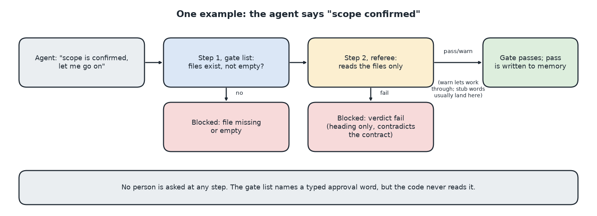
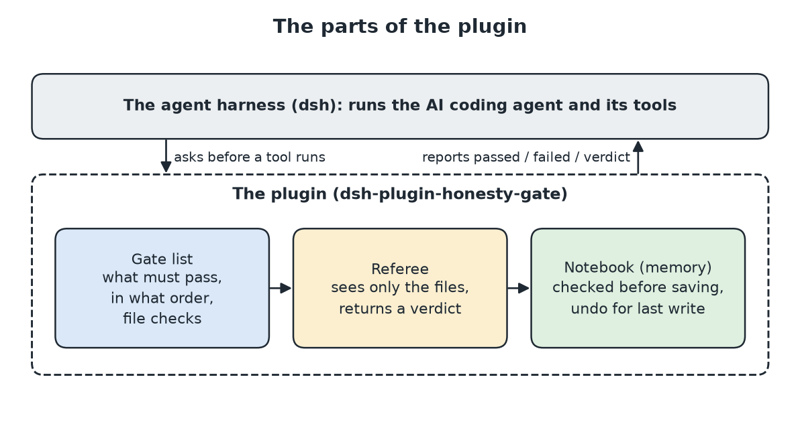
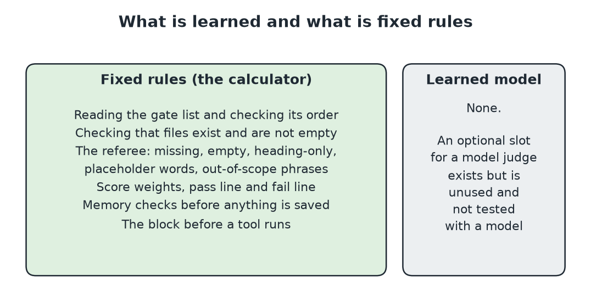
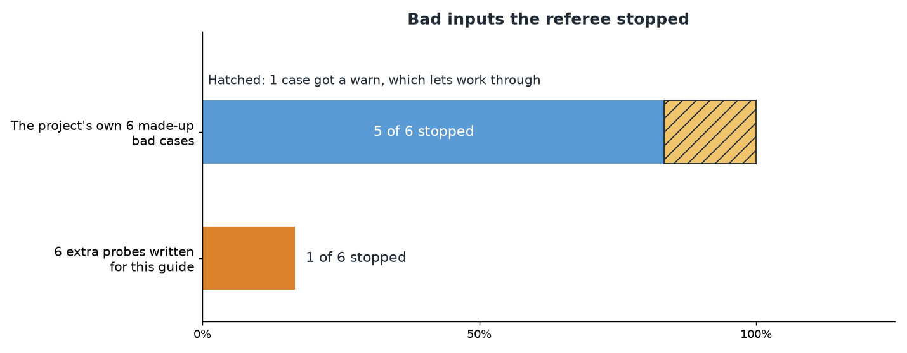

# dsh-plugin-honesty-gate

*A small add-on for an AI (artificial intelligence) coding agent's work area that blocks a "done" claim until fixed checks pass. It contains no AI model: every decision is a fixed rule. Despite the name, it checks that files exist and match simple patterns; it does not detect dishonesty.*

Status: paused after four planned phases, last commit, a documentation note, on 4 September 2026. Code: https://github.com/PCSchmidt/dsh-plugin-honesty-gate (public, MIT (Massachusetts Institute of Technology) licence, a permissive open-source licence). It has no stars and no forks, and nothing shows that anyone but me has used it.

Here is the one example I use throughout. An AI coding agent working in a project says, "the scope is confirmed, let me go on." The plugin does not take its word for it. First it asks whether the two scope files, a contract (what the project must and must not do) and a spec (how it will do it), exist and are not empty. Then a separate piece I call the *referee* reads those files and nothing else, with no view of how the agent argued its case. If the spec is only a heading, the referee's verdict is "fail" and the agent is stopped. If the files pass, the result is recorded and the agent moves on.



The idea comes from Meridian, an earlier project of mine: scripts and rules wrapped around an AI coding agent that stop it from saying work is finished until a check passes. This plugin carries that idea into a different program, dsh (DeepSeek Harness). The description file (the README) links dsh to a public repository by deepseek-ai and calls it a *harness*, meaning a program that runs an AI agent and the tools the agent may use. It accepts *plugins*, add-on pieces of code, and the plugin format the README names is Cordis. This repository does not contain dsh, and this guide describes dsh and Cordis only as far as the README does. A *gate* is a checkpoint that work must pass before it moves on.

The name promises more than the check does, so I say this plainly. The plugin is a file-existence and pattern check. It passes vague text with no real content: "We will make something good for users" scored 9.6 out of 10, near the top. Of six harder probes written for this guide, it stopped only 1. "Honesty gate" should be read as "a gate that looks for missing or stub files", not as a lie detector.

Now the status and the numbers, which I state once and refer back to. The plugin's own test suite has 32 tests and all pass. Its small evaluation set of 8 cases is scored 8 of 8 right. Five of its 6 bad cases were stopped and the sixth, a stub, drew only a "warn" that lets work through; the cases were also written alongside the rules, in the same commit. The plugin has never been loaded into the real dsh: the status file lists the live install as not done, and it needs dsh's command-line program. So the strongest claim, that it works inside a real agent program, has not been shown. AI coding agents wrote almost all of the code, and I directed the scope, plan, architecture and preferences. If you have ten minutes, read the chapters on how it works, on trying to break it, and on real use.

In short, this is a small, paused piece of enforcement code that works on its own tests, whose name overstates what it checks.

## What problem this solves

AI coding agents tend to announce that work is finished when it is not. Anyone who lets an agent run unattended and then trusts its report has this problem; without a checkpoint they read the summary or open every file themselves. Meridian was my earlier answer. This repository re-implements the same written agreements, which say what a pass means, what a verdict record contains and how memory is stored, inside dsh, and it does not add a second gate language. 

The repository defines success as catching at least 85 percent of a small set of known-bad examples, with the referee's verdicts agreeing with the labels. Both measures exist today. What does not exist is any measure from a live agent session.

The plugin deliberately does not do several things. It calls no language model or outside service and needs no key. It does not start dsh. And per the README it allows only public, unclassified data (information with no security restriction).

A skeptic would ask why not run the checks as an ordinary test script. The fair answer is that a plugin can sit in front of the agent's tool use and refuse each request as it happens, which a script run afterwards cannot. The weaker half of the answer is that this refusal has been tried only with fake requests, not in the real dsh.

In short, the problem is agents saying "done" without evidence, and the plugin's answer is a checkpoint that reads the files.

## What it does, step by step

The plugin keeps a *gate list*: a short file naming each checkpoint, what it requires, and which checkpoints must pass before it. The example list has two gates. "Scope Confirmed" requires the contract and spec files to exist. "Tests Present" requires a tests folder and can only start after the first has passed.

Return to the example. The agent says the scope is confirmed and the plugin is asked to advance that gate.

First comes the file check. The plugin looks in the project folder for the contract and spec. A missing file, or one with nothing in it, stops everything. The plugin is *fail-closed*: when something is wrong it refuses, rather than letting the request through. If the files are there, the next step runs.

Second comes the referee. It receives only the gate's name, the text of the required files and a short description of the gate. If a request carries anything else, such as the agent's chat history or a score the agent gave itself, the referee drops it before judging. The referee then looks for problems. A file that is missing, empty or only a heading is a serious problem. A file containing words such as "todo", "placeholder" or "coming soon" is a medium problem, which on its own usually leaves the score in the warn range, so the work goes through. A spec that repeats, nearly word for word, something the contract lists as out of scope is also serious. It gives four marks from 0 to 10, for completeness, quality, consistency and fit to the spec, and combines them into one score. A score of 7.0 or more with no serious problem is a "pass". From 5.0 up to 7.0 is a "warn". Below 5.0, or any serious problem at all, is a "fail". A fail stops the gate; a warn lets it through. The weights and cut-offs come from Meridian, and the repository does not say how they were picked.

Third, if the verdict is not a fail, the gate is marked passed and the plugin writes a line to its notebook. The notebook, which the code calls memory, is a folder of three files: a list of lessons, a log of events and a list of corrections (predicted hours set against actual hours). The log and the corrections list are only ever added to, never rewritten. Every write is checked against a fixed format first, and a bad write is refused and not saved. The last write can be undone.

The plugin also installs one *hook*, a point where a plugin can step in, that runs before dsh uses any tool. If the current gate fails its file check, the hook returns a refusal and the tool use never happens. Only the file check runs here, not the referee.

Nobody is asked to approve anything. The example gate list says the first gate needs a typed approval word and carries one, but no code reads it, so no person is ever in the loop. I come back to this later.

The intended user is a developer who already runs dsh and wants this check in front of an agent. A government or other regulated setting would first need the live-install check, and then data handling and review that this repository does not contain.

In short, the plugin checks that the files exist, has a referee judge them, records the result, and blocks tool use while the file check fails.

## How it works: parts, data and tools

The plugin has three working parts and a connector that joins them to dsh, shown below.



The *gate list reader* loads the gate list from a YAML (YAML Ain't Markup Language) file, a plain-text format for lists of settings that people find easy to read. It refuses a list with an unknown name or a circle, where the first gate waits on the last. It also runs the two built-in file checks: "the files exist and are not empty", and "the tests folder exists". The *referee* is the piece described above; the code calls it the Evaluator, and I use "referee" throughout. The *notebook* is the memory store. The connector links all three to dsh, and it works without dsh too, because it only needs a plain stand-in object to attach to; that is how the tests run.

Four rules must never be broken. A gate does not pass if its file check fails. An agent's self-score does not reach the referee. A bad memory write is not saved. A referee verdict that does not match the fixed format is not returned. These are enforced in code, and the tests exercise most of them. The chapter on trying to break it shows where the rules are weaker than they sound.

The data is small and local: gate files, the project's scope files and the notebook folder. Nothing is fetched, and the only data in the repository is a handful of made-up test cases.

The tools are few. The code is JavaScript running on Node.js, a way of running JavaScript outside a web browser, version 20 or newer. The only outside package is a small YAML reader. An automatic run on GitHub (the code-hosting website) repeats the tests and the evaluation after each change. The repository does not say why JavaScript was chosen.

In short, the parts are a gate list, a referee and a notebook, joined to dsh by a connector that can run without it.

## The methods, and why there are no models

The plugin contains no learned model and no probabilistic part. Think of a calculator, which gives the same answer to the same sum every time, against a weather forecast, which is a best guess that can be wrong. This plugin is the calculator. The forecast-like part is the AI agent it is meant to keep in check, which is somebody else's program, and a referee that uses a model is a slot the code leaves empty.



Given the same files and the same gate list, the plugin returns the same verdict every time, apart from a timestamp and a random session label it makes up when none is given. That sameness is real, but it does not make the verdicts right. A rule can be repeatably wrong, as the probes below show.

There is almost no mathematics: one weighted average of the four marks, and a short rule turning it into pass, warn or fail. Toy example: marks of 8, 6, 8 and 8, with completeness counting for slightly more than quality, come to about 7.5, which is a pass. The 0-to-10 marks are not probabilities, and nothing checks them against outcomes.

Why no model? The README calls the referee "mechanical and adversarial" and says it needs no key for a paid AI service. A model-based referee might catch fluent but empty text, but it would cost money, vary between runs and add a new thing that can be wrong. The repository allows an optional *judge callback*, a function someone could supply to give the marks instead, and its own next-step note says a judge built on an LLM (large language model, an AI system trained on large amounts of text), compared on the same cases, would be the next addition. No such judge has been written or tested, so I cannot say what it would add.

In short, everything here is fixed rules, which makes it repeatable but does not make it right.

## Testing and safeguards

The repository has 32 tests in five files, for the connector, the gate list reader, the referee, the notebook and the evaluation set. All 32 pass in a scratch copy, in under a second. They are *unit tests*, each checking one small piece on its own, plus a few where pieces work together. None starts the real dsh. The three automatic runs in the history all succeeded.

The planned cases are handled: missing and empty files, circular gate lists, bad memory records and attached self-scores.

Six extra probes, written for this guide and run in a scratch copy rather than in the repository, were aimed at things a gate ought to stop. Only one was stopped.

- Vague text with no real content ("We will make something good for users") passed, scoring 9.6.
- A spec asking for a login and password feature passed, though the contract ruled out a "user authentication system". The check looks for the contract's exact wording. It fires when the plugin reads the project's own contract and spec files, but a paraphrase slips past it, and so does a request that hands the files over only as attachments.
- A file named "old/NOTCONTRACT.md" passed as the required contract, because the check only asks whether the name ends the same way.
- The tests gate passed with an empty tests folder.
- The "Scope Confirmed" gate, which is declared a human approval gate, advanced with no human anywhere, because the approval word is never used.
- The one probe it stopped was the same out-of-scope item written in capital letters.



Two smaller defects showed up. The word "todo" matches inside ordinary words, so a text about a mastodon was flagged as a stub, and the step that removes praise words cuts them out of the middle of other words ("greater" becomes "er").

The biggest thing not tested is the plugin inside the real dsh, and hostile input beyond these ordinary cases is untested. A referee that is too easily satisfied is a design limit, because text patterns cannot judge meaning.

In short, the plugin does what its tests ask, and the extra probes show how far those tests stand from harder cases.

## Does it work? The results

The repository's evaluation set has 8 cases: 6 known-bad and 2 known-good. The bad ones are a missing file, a heading-only file, a stub, a spec that breaks a contract rule, a missing file with a self-score attached, and an empty file. A run in a scratch copy reproduces what the repository's documents report: all 8 verdicts match their labels and all are in the required format. Five of the 6 bad cases get "fail" and are stopped; the stub case gets "warn", which lets work through, and the repository's catch count still counts it.

What that means is limited. A do-nothing gate that passed everything would catch 0 of 6, so 5 stopped and 1 flagged is a real difference, but only for these cases. The repository calls the set "held-out", a word that normally means cases kept aside and unseen while the rules were built. Here they were written alongside the rules, so the set is closer to a check that the rules do what they were written to do. The self-score case would fail anyway because its file is missing. A separate check for this guide showed that a good file with a self-score of 9.8 attached passes, which is what dropping the self-score should do, but the repository's own test does not show it. Six bad cases cannot say how often the referee fails in general, and no range is given. The six extra probes are too few to give a rate either, but they show that the repository's own result does not carry over to harder cases.

In short, the plugin does well on cases written alongside its rules and poorly on the first harder cases tried.

## Could it be put into real use?

It has never run outside my machine and GitHub's automatic checks. On a four-step ladder of experiment, works locally, deployable and operated, it sits at works locally: it runs and passes its own tests, but it has not been hosted, tried by others or watched in use.

Against what employers tend to look for: someone else can run it from a clean copy in three commands, and the automatic run can fail the build. It fails closed on bad inputs, and it has no cost limits because it calls nothing. People cannot approve or stop steps, because the approval gate is not enforced. A quick search of the tracked files found no keys.

The gap to deployable is mainly the live check: install dsh, load the plugin and show a refusal from a real agent run. Three small steps would help most. First, run the live check and record the result, which would show that the plugin loads, not that the referee is good. Second, add the failing probes to the evaluation set and fix the checks, which would show the rules hold against harder input. Third, make the approval word actually required. None would show the plugin helps in real work.

Its reusable part is the pattern of a gate in front of tool use, a referee that sees only the files, and a notebook that refuses bad writes.

In short, it works locally and is paused short of the one test that would put it in front of a real agent.

## Strengths, shortcomings and the work still to do

The strengths are modest and concrete. The design is specific: the referee's input is a fixed list of fields, the verdict has a fixed shape, and bad records are refused. The status file lists what was not done, including the live check and the model judge.

The shortcoming that matters most is the referee's weakness against content that sounds fine, which is also why the name overpromises. The options are to widen the pattern checks (small effort, but easy to get around and prone to false alarms, meaning good text flagged as bad), or to add the optional model-based judge (medium effort; it catches more but costs money, varies between runs, and brings back the question of who checks the checker). The sensible first step is to add the failing probes to the evaluation, so any change can be measured. Second is the approval gate: it should either be enforced or dropped from the example, and the README does not mention this. Third, the "held-out" label should say "cases written alongside the rules". A pass from this referee should not be read as proof that a file is good.

Built: the connector, gate list reader, referee, notebook, example setup, evaluation and automatic run. Planned only: the live install check, the model judge, and a topic label on the GitHub page. The next small milestone is the live check, finished when a real agent run is refused by the hook.

In short, the plugin is a small start whose referee and approval gate need work before it does what its name suggests.

## How it was built, and who did what

AI coding agents wrote almost all of the code, and I directed the scope, plan, architecture and preferences. The repository's instruction file for coding agents sets rules such as validating before writing and not starting extra work while the project is paused. The history has seven commits, six of them on 19 August 2026 (five phases and a pause note), and a final documentation note on 4 September. It is too coarse to show whether the agents made mistakes that were later fixed. How their work was checked is not recorded beyond the tests and the evaluation.

In short, I set the scope and the rules, agents wrote the files, and the history is too short to say more.

## For recruiters and interviewers

**In thirty seconds.** I directed AI coding agents to build a plugin that blocks an AI agent from moving on until fixed checks pass and a referee, who sees only the files, does not fail the work. It is small and paused. The tests pass, but the referee misses vague text, and it has not run in the real agent program.

**What it shows.** Specifying a contract and building a small fail-closed system around it, keeping the judge separate from the agent, and stating what is not done. **What it does not show.** Using or training a model, running anything for users, scale, teamwork or hand-written code. The nearest role family is applied agentic-workflow engineering, in the governance sense, and the fit is partial. It is a weak fit for machine-learning engineering with MLOps (machine-learning operations, the work of running models in production) and for forward-deployed work, where an engineer builds inside a customer's setting. Of my target titles it supports AI Engineer more than Forward Deployed AI Engineer, and only lightly.

**Likely questions, with short answers.**

- *Is this just a wrapper around an AI service?* No. It calls no model at all.
- *If AI wrote it, what did you do?* I set the scope, the plan, the architecture and my preferences.
- *Does it detect dishonest agents?* No. It checks that files exist and match simple patterns, and it passed vague text.
- *Why should I believe the numbers?* See the results chapter: the 8 cases were written with the rules, and the harder probes did badly.
- *Have you run it for real users?* No, and not in the real dsh either.
- *What would you change first?* Add the failing probes to the evaluation and make the approval gate real.
- *How would you explain it to an executive?* An agent saying "done" is not evidence. This puts a checkpoint in front that looks at the files, though a weak one.

## Glossary

- **Gate:** a checkpoint that work must pass before it moves on.
- **Referee:** the part that judges the work from the files alone (the code calls it the Evaluator).
- **Verdict:** the referee's result: pass, warn or fail.
- **Hook:** a point where a plugin can step in, here before a tool runs.
- **Harness:** a program that runs an AI agent and the tools it may use.
- **Fail closed:** refuse when something is wrong, instead of letting it through.

## Where to look in the code

This list is for engineers; other readers can stop here.

```
dsh-plugin-honesty-gate/
  index.js     entry point that exposes the plugin
  src/         connector, gate list reader, referee, verdict rules, memory store
  schemas/     verdict and memory formats
  eval/        8 cases and the script that scores them
  examples/    sample gate list, scope files and profile
  tests/       32 tests in five files
  .github/     the automatic run
```

It needs Node 20 or newer; the install, the test command and the evaluation command all worked in a scratch copy. Read first: the README, the connector, the referee, the verdict rules and the evaluation cases.
